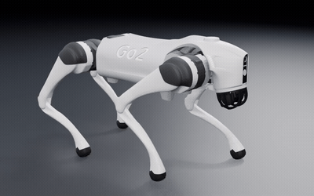
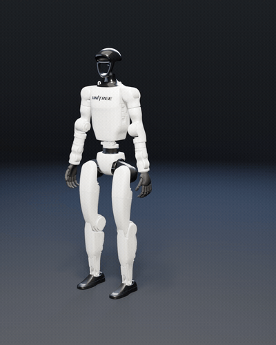
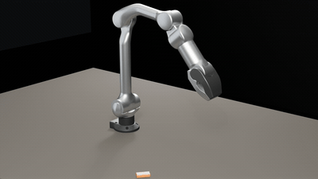
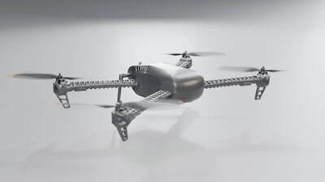
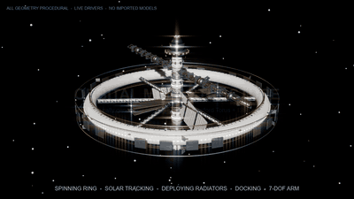

# OpenCode × Blender Bridge

Drive a real Blender session from OpenCode: look at the viewport, change one thing, look again — then batch, render, audit and export. Parametric CAD parts can come from **Atta**: measured facts, a three-state verify gate, and Blender-backed delivery.

**English** | [简体中文](README.zh-CN.md)

- **GUI first.** The agent works against the Blender session you are looking at and gets a frame after every change.
- **Headless fallback.** No GUI? A persistent `blender -b` worker serves the same command surface, frames included.
- **16 tools.** `see`, `do`, `watch`, `plan`, `worker`, `viewport`, `headless`, `job`, `loop`, `txn`, `preset`, `perf`, `opt`, `cmd`, `commands`, `cad`.
- **Parametric CAD.** Atta specs and 23 recipes: facts before pixels, `pass`/`degraded`/`fail` verification, GLB/STEP delivery, import into the live scene.
- **56 add-on commands.** Scene, objects, materials, cameras, lights, render, export, audit and performance.
- **Local only.** The bridge listens on `127.0.0.1:9876` and never leaves the machine.

Tested with **Blender 5.2.2 LTS on Windows** and the **OpenCode V2** plugin API (`@opencode/plugin` 2.2.x). Targets Blender 4.2+.

---

## 1. Install

### Step 1 — Blender add-on (required)

1. Download [`assets/addon/opencode_blender_bridge.zip`](assets/addon/opencode_blender_bridge.zip) or the asset from the [latest release](https://github.com/wuuwuu26/opencode-blender-bridge/releases/latest).
2. In Blender: `Edit > Preferences > Add-ons > Install from Disk…`, select the zip.
3. Enable **OpenCode Blender Bridge**.
4. In the 3D viewport press `N`, open the **OpenCode** sidebar and click **Connect**. The add-on auto-starts with Blender by default.

> Do not enable another add-on that serves Blender on port `9876` (for example `MCP for Blender` / `blender_mcp`); they compete for the port. Ordinary modeling, material and render add-ons are unaffected.

### Step 2 — OpenCode plugin

Clone the repository, then add it to `plugins` in your project or global `opencode.json(c)`:

```jsonc
{
  "$schema": "https://opencode.ai/config.json",
  "plugins": [
    "C:/Users/you/Documents/opencode-blender-bridge"
  ]
}
```

Or pass options explicitly:

```jsonc
{
  "plugins": [
    {
      "package": "C:/Users/you/Documents/opencode-blender-bridge",
      "options": {
        "port": 9876,
        "blenderPath": "C:/Program Files/Blender Foundation/Blender 5.2/blender.exe",
        "frameMaxSize": 720,
        "workerTtlMs": 900000
      }
    }
  ]
}
```

OpenCode reloads configuration automatically. Building from source the first time:

```bash
cd opencode-blender-bridge
npm install
npm run build
```

### Step 3 — Verify

Ask the agent to run:

```text
blender_viewport(op="doctor")
```

The GUI acceptance criterion is `kind=ok`.

- `kind=gui_offline` — Blender is installed but the bridge is not connected: use the N panel **Connect**, or `blender_viewport(op="launch")`.
- `kind=background_only` — the plugin is talking to a headless worker, not a desktop Blender.
- `kind=no_blender` — the executable was not found: set `blenderPath` or `OCBB_BLENDER`.

Headless-only acceptance:

```text
blender_rt_worker(op="start", name="main")
blender_rt_worker(op="see", name="main")
```

A returned frame means the fallback works.

---

## 2. Tools

| Tool | What it does |
| --- | --- |
| `blender_rt_see` | Viewport frame, custom camera angle or full-window screenshot; identical frames are not re-attached |
| `blender_rt_do` | Run Python on Blender's main thread, optionally return a frame |
| `blender_rt_watch` | Sample a time window or frame range and report whether the image changed |
| `blender_rt_plan` | Capability catalog and standard modeling/material/render/export operations |
| `blender_rt_worker` | Persistent headless session: start / exec / see / reset / status / stop / restart / list |
| `blender_viewport` | Status, health, doctor, launch and an advisory write lease |
| `blender_rt_headless` | One-shot `blender -b` script with stdout, structured result and new files |
| `blender_rt_job` | Background long jobs: start / status / result / wait / cancel / list |
| `blender_rt_loop` | Parameter search in one persistent worker, ranked by a metric |
| `blender_rt_txn` | `.blend` snapshots and object transform marks with rollback |
| `blender_rt_preset` | Save, list, apply and export reusable presets |
| `blender_rt_perf` | Render performance diagnosis and fast/balanced/quality profiles |
| `blender_rt_opt` | Report safe merge candidates (merging is explicit) |
| `blender_rt_cmd` | Call any add-on command directly |
| `blender_rt_commands` | List the add-on commands available right now |
| `blender_rt_cad` | Parametric CAD via Atta: spec/model/describe/verify/preview/deliver/import/setup |

### Typical flow

```text
blender_rt_plan(op="catalog")
blender_rt_plan(op="object.create", args={kind:"cube", name:"Body", location:[0,0,1]})
blender_rt_plan(op="material.create", args={name:"BodyMat", base_color:"#3a6ea5", roughness:0.4})
blender_rt_plan(op="material.assign", args={name:"Body", material:"BodyMat"})
blender_rt_see(max_size=720)
blender_rt_txn(op="snapshot", name="before-boolean")
blender_rt_plan(op="export.scene", args={filepath:"out/body.glb"})
```

Modeling goes through `blender_rt_plan`. Use `blender_rt_do` only for edits the standard operations do not cover.

---

## 3. Compared with a typical Blender MCP server

Both drive a real Blender session from an agent. A typical Blender MCP server — [`ahujasid/blender-mcp`](https://github.com/ahujasid/blender-mcp) is the common example — puts a small add-on and a socket in front of Blender, exposes scene/object queries, a viewport screenshot and `execute_blender_code`, and often adds asset-library integrations (Poly Haven, Sketchfab, Hyper3D Rodin). That is enough to let a model change a scene.

This plugin keeps the same GUI-first idea and adds the layer around the edit:

| | Typical Blender MCP | This bridge |
| --- | --- | --- |
| Integration | A standalone MCP server over stdio, used by any MCP client | An OpenCode plugin: 16 native tools plus a skill, no extra server process |
| Edit surface | Mostly `execute_blender_code` | A `plan` catalog of validated operations; `do` is the explicit escape hatch |
| Sessions | One connected Blender | GUI session, persistent `blender -b` worker, one-shot headless, background jobs, parameter loops |
| Undo | None | `txn` snapshots of `.blend` files and object transforms, with rollback |
| Confirming a change | You look at a screenshot | `see` hashes frames and skips identical ones; `watch` samples a window and reports whether the image changed |
| Batch and performance | Little | `preset`, `perf` profiles, `opt` merge candidates, batch render and export |
| CAD | Usually asset libraries | Atta parametric CAD: spec-as-model, measured `describe`, three-state `verify`, GLB/STEP `deliver` |
| Output | Actions inside the session | Files in the workspace with `report.txt` / `PROVENANCE.txt` / `progress.json` — reproducible and auditable |

- **Plan instead of ad-hoc Python.** `blender_rt_plan` validates arguments against a capability catalog, so repeated work looks the same each time and can be scripted; `blender_rt_do` stays available for anything the catalog does not cover.
- **GUI and headless are one command surface.** A persistent `blender -b` worker serves the same requests, frames included; `job` moves long work to the background and `loop` sweeps parameters in one worker, ranked by a metric. A socket-only MCP normally stops at the open GUI.
- **Rollback and verification.** `txn` snapshots the file or records object transforms before a risky step, `see` avoids spending vision tokens on unchanged frames, and the CAD side returns `pass` / `degraded` / `fail` with a receipt — `deliver` refuses a result that did not pass.
- **Deliverables are files.** The robot assembly example at the end of this README runs entirely through headless builds and writes `report.txt` with measured numbers; that workflow is what `worker` / `job` / `txn` / `verify` exist for.

Rough rule: for a one-off "move this object and show me", a typical Blender MCP is the shorter path. For repeatable asset production, verified delivery, or long unattended runs, the `plan` + worker + job + txn + verify layer is the point.

---

## 4. Parametric CAD with Atta

The plugin fuses [Atta](https://github.com/laszapens/Atta) (MIT), an LLM-native
parametric CAD kernel, as the `blender_rt_cad` tool. It is optional: the Blender
tools work without it.

- **The spec is the model.** Recipes or `atta.spec/v3` graphs rebuild deterministically.
- **Facts before pixels.** `describe` returns bbox, volume, topology, wall thickness, rays and ASCII sections in well under a second.
- **Three-state gate.** `verify` returns `pass` / `degraded` / `fail` with a receipt; `deliver` refuses anything not `pass` (or `degraded` with an explicit override).
- **Blender-backed delivery.** `preview` renders with a resident Blender worker; `import` delivers a GLB and loads it into the live OpenCode Blender session.

### Install Atta

```text
blender_rt_cad(op="setup")
```

This creates `.opencode/atta-venv` and installs Atta from
`git+https://github.com/laszapens/Atta.git`. Override with `source` or set
`attaPython` to an existing Python that can `import atta`. Manual install:

```bash
python -m venv .opencode/atta-venv
.opencode/atta-venv/bin/python -m pip install "git+https://github.com/laszapens/Atta.git"
# Windows: .opencode\atta-venv\Scripts\python.exe
```

Requires Python 3.10+ and `numpy`, `scipy`, `trimesh`, `manifold3d`, `pillow`
(installed automatically). STEP export additionally needs the `brep` extra
(`build123d`).

### Workflow

```text
blender_rt_cad(op="doctor")
blender_rt_cad(op="catalog", args={verbose:true})
blender_rt_cad(op="model", args={recipe:"part.bracket",
  params:{length:120, width:70, thickness:8, hole_radius:6}})
blender_rt_cad(op="describe", args={wall:true, perceive:true})
blender_rt_cad(op="verify", args={constraints:{bbox:{x:[110,130]}, min_wall_mm:2.5}})
blender_rt_cad(op="preview", args={views:["hero"], res:1200})
blender_rt_cad(op="deliver", args={formats:["glb","step"]})
blender_rt_cad(op="import", args={name:"bracket-01"})
```

`import` runs `deliver` for GLB, imports the file into the connected Blender GUI
and returns a frame. `setup`, `status` and `import` are plugin ops; the other ops
map one-to-one to the ten Atta tools (`doctor`, `catalog`, `spec`, `model`,
`variant`, `describe`, `verify`, `preview`, `deliver`, `run`).

---

## 5. Configuration

| Option | Default | Description |
| --- | --- | --- |
| `port` | `9876` | Add-on port; must match the Blender side |
| `blenderPath` | auto-detect | Blender executable; also `OCBB_BLENDER` / `BLENDER_PATH` |
| `frameMaxSize` | `720` | Default longest edge for `see` |
| `workerTtlMs` | `900000` | Idle timeout for headless sessions |
| `attaPython` | auto-detect | Python that can `import atta`; also `ATTA_PYTHON` |
| `attaRoot` | — | Optional Atta checkout root; also `ATTA_ROOT` |
| `attaHome` | `.opencode/atta` | Atta workspace; also `ATTA_HOME` |
| `attaRepo` | GitHub Atta | pip source used by `op=setup` |

Environment variables: `OCBB_PORT`, `OCBB_BLENDER`, `OCBB_WORKER_TTL_MS`,
`ATTA_PYTHON`, `ATTA_ROOT`, `ATTA_HOME`.

---

## 6. Architecture

```text
OpenCode server
  └─ plugin (TypeScript, @opencode/plugin)
       ├─ 16 tools
       ├─ BridgeClient ── TCP 127.0.0.1:9876 ── Blender add-on (Python)
       │                                          └─ main-thread command queue
       ├─ WorkerManager ── blender -b worker.py ── same command surface
       ├─ AttaBridge ── python -m atta tool ── Atta CAD kernel
       │                                   └─ resident Blender worker (preview/deliver)
       ├─ JobManager / headless runner
       └─ .opencode/blender/{runs,jobs,presets.json,txn}
          .opencode/atta/{_atta,...}
```

- Flat JSON protocol: request `{"type": "...", "params": {...}}`, response `{"status":"success","result":...}` or `{"status":"error","message":...}`.
- Every `bpy` call runs on Blender's main thread; the socket only transports requests.
- The headless worker owns the main loop in `blender -b`, so commands and Workbench frames work without a window.
- `see` hashes each frame and skips re-attaching an identical image (`force=true` overrides), saving vision tokens.

---

## 7. Security

- The bridge binds to `127.0.0.1` only and has no authentication. Any local process can connect; never expose it to the internet.
- `blender_rt_do` / `execute_code` run arbitrary Python with your user permissions.
- **Pause AI** in the Blender N panel rejects all write commands while keeping read-only queries available.
- Snapshots write under `.opencode/blender/txn`; they never overwrite a saved `.blend` unless you explicitly call `file.save`.
- Atta runs as a local subprocess with your user permissions and writes its workspace under `.opencode/atta`. Specs and models come from the model, so treat third-party specs like code.

---

## 8. Development

```bash
npm install
npm run build          # TypeScript → dist
npm run package:addon  # build assets/addon/opencode_blender_bridge.zip
```

Tests:

```bash
# add-on smoke test through a headless worker
blender --background --factory-startup --python assets/worker.py -- \
  --port 51234 --addon-path assets/addon
python tests/smoke.py 51234

# plugin tool layer against the worker/GUI bridge
node tests/plugin-smoke.mjs

# Atta CAD integration (needs blender_rt_cad op=setup)
node tests/cad-smoke.mjs
```

Layout:

```text
assets/addon/opencode_blender_bridge/   Blender add-on
assets/worker.py                        persistent headless worker entry
assets/launch.py                        launch the GUI with the add-on loaded
assets/headless_wrapper.py              one-shot blender -b wrapper
src/                                    OpenCode plugin
skills/blender-modeling/SKILL.md        bundled modeling skill
skills/cad-modeling/SKILL.md            Atta parametric CAD skill
```

---

## 9. Example: robot mesh assembly and animation

A worked application example of this bridge: turn open-source robot descriptions (URDF / xacro / SDF) and their official meshes into Blender scenes with a link/joint hierarchy, materials and looped animations, then batch-render stills, MP4/GIF and verification reports. One generic forward-kinematics pipeline was reused across a quadruped, a humanoid, a 6-DOF arm and a quadcopter — see [docs/robot-assembly-and-animation.md](docs/robot-assembly-and-animation.md) for the method, use cases, measured results and reproduction steps.

<table>
  <tr>
    <td align="center" width="50%">
      <br>
      <sub><b>Quadruped</b> — 48-frame trot, URDF FK, 12 DOF</sub>
    </td>
    <td align="center" width="50%">
      <br>
      <sub><b>Humanoid</b> — 96-frame idle + wave, 39 links / 29 DOF</sub>
    </td>
  </tr>
  <tr>
    <td align="center" width="50%">
      <br>
      <sub><b>6-DOF arm</b> — 96-frame pick, carry and place (IK)</sub>
    </td>
    <td align="center" width="50%">
      <br>
      <sub><b>Quadcopter</b> — 48-frame prop spin and hover loop</sub>
    </td>
  </tr>
</table>

## 10. Example: procedural animated orbital megastructure

A second worked example, this time with **zero external 3D assets**: starting from the empty default scene, a photoreal, fully animated space station megastructure is generated entirely from procedural `bpy` geometry (torus, triangular space-frame trusses, a parabolic dish, merged greebles, Geometry Nodes star instancing). The spinning habitat ring + spokes are separated from the non-rotating axial keel, dual-gimbal solar wings, deployable radiators, antenna, 7-DOF arm and docking craft by visible bearing / slip-ring hardware — the rotating / non-rotating split that makes a rotating station credible. Every mechanism is a live driver (ring spin, sun tracking, radiator deployment, docking approach, slow shield counter-rotation), with no keyframe baking. See [docs/orbital-megastructure.md](docs/orbital-megastructure.md) for the structural grammar, the 8-phase build, the animation list, measured results and reproduction steps.

<p align="center">
  <br>
  <sub><b>Orbital megastructure</b> — 960×540, 8 fps GIF: spinning ring, solar tracking, deploying radiators, docking, 7-DOF arm. All geometry procedural, live drivers, no imported models.</sub>
</p>

As with the robot example, the `.blend`, video, stills and build scripts stay in the local workspace and are not distributed with this repository; only the write-up and the demo GIF are included.

## 11. License and credits

Licensed under the **Apache License 2.0**. See [LICENSE](LICENSE) and [NOTICE](NOTICE).

The robot meshes in the robot-assembly example are the official upstream assets, used under their own licenses: Unitree Go2, G1 and Z1 from [unitreerobotics/unitree_ros](https://github.com/unitreerobotics/unitree_ros) (BSD-3-Clause), and PX4 Iris from [PX4/PX4-gazebo-models](https://github.com/PX4/PX4-gazebo-models) (BSD-3-Clause). Robot names and logos belong to their respective owners; this example implies no endorsement. The orbital-megastructure example uses no external 3D assets at all (all geometry is generated in code).

Inspired by and in a few small places adapted from:

- [sixtysevenlf/dsh-blender-plugin](https://github.com/sixtysevenlf/dsh-blender-plugin) (BSD-3-Clause) — GUI-first + headless-fallback workflow, 15-tool surface and flat protocol shape;
- [ahujasid/blender-mcp](https://github.com/ahujasid/blender-mcp) (MIT) — Blender socket command pattern and offscreen viewport capture;
- [laszapens/Atta](https://github.com/laszapens/Atta) (MIT) — parametric CAD kernel, integrated as the optional `blender_rt_cad` tool; Atta itself is installed separately and remains under its own license.

Blender is a trademark of the Blender Foundation. This project is not affiliated with or endorsed by the Blender Foundation.
