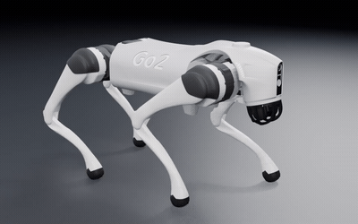
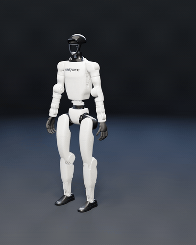
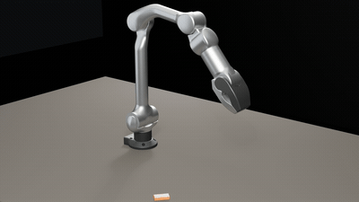
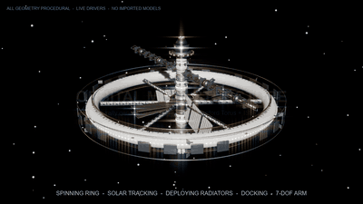

# OpenCode × Blender Bridge

让 OpenCode 直接驱动一个真实的 Blender 会话：看视口、改一步、再看一眼，并能无头批处理、渲染、审计和导出。参数化 CAD 零件可交给 **Atta**：量测事实、三态验证、Blender 交付。

[English](README.md) | **简体中文**

- **GUI 优先**：Agent 操作你正在看的那个 Blender 场景，每次改完立刻回一帧。
- **无头可用**：没有 GUI 时自动降级到常驻 `blender -b` worker，视口帧仍然在。
- **16 个工具**：`see / do / watch / plan / worker / viewport / headless / job / loop / txn / preset / perf / opt / cmd / commands / cad`。
- **参数化 CAD**：Atta spec 与 23 个 recipe；先量测后出图，`pass`/`degraded`/`fail` 三态验证，GLB/STEP 交付并导入当前场景。
- **56 个 add-on 命令**：场景、对象、材质、相机、灯光、渲染、导出、审计、性能。
- **只走本机回环**：监听 `127.0.0.1:9876`，不经过任何云服务。

已在 **Blender 5.2.2 LTS / Windows** 和 **OpenCode V2** 插件 API（`@opencode/plugin` 2.2.x）上测试；目标兼容 Blender 4.2+。

---

## 1. 安装

### 第一步：安装 Blender 插件（必须先做）

1. 下载 [`assets/addon/opencode_blender_bridge.zip`](assets/addon/opencode_blender_bridge.zip)，或从 [最新 Release](https://github.com/wuuwuu26/opencode-blender-bridge/releases/latest) 下载。
2. Blender → `Edit > Preferences > Add-ons > Install from Disk…`，选择 zip。
3. 勾选 **OpenCode Blender Bridge**。
4. 在 3D 视口按 `N`，打开 **OpenCode** 侧栏，点 **Connect**。插件默认会随 Blender 自动启动。

> 不要同时启用其他在 `9876` 端口提供 Blender 桥的插件（例如 `MCP for Blender` / `blender_mcp`），它们会抢端口。普通建模、材质、渲染插件不受影响。

### 第二步：安装 OpenCode 插件

克隆本仓库，然后在项目或全局 `opencode.json(c)` 的 `plugins` 中加入路径：

```jsonc
{
  "$schema": "https://opencode.ai/config.json",
  "plugins": [
    "C:/Users/you/Documents/opencode-blender-bridge"
  ]
}
```

也可以使用对象形式传配置：

```jsonc
{
  "plugins": [
    {
      "package": "C:/Users/you/Documents/opencode-blender-bridge",
      "options": {
        "port": 9876,
        "blenderPath": "C:/Program Files/Blender Foundation/Blender 5.2/blender.exe",
        "frameMaxSize": 720,
        "workerTtlMs": 900000
      }
    }
  ]
}
```

保存后 OpenCode 会自动重载配置。第一次从源码使用先构建一次：

```bash
cd opencode-blender-bridge
npm install
npm run build
```

### 第三步：验收

让 Agent 调用：

```text
blender_viewport(op="doctor")
```

**唯一的 GUI 验收标准**是返回 `kind=ok`。

- `kind=gui_offline`：Blender 已安装但桥没连上 → 在 Blender 的 N 面板点 Connect，或运行 `blender_viewport(op="launch")`。
- `kind=background_only`：当前连的是无头 worker，不是桌面 Blender。
- `kind=no_blender`：找不到 Blender 可执行文件 → 设置 `blenderPath` 或环境变量 `OCBB_BLENDER`。

只有无头环境时：

```text
blender_rt_worker(op="start", name="main")
blender_rt_worker(op="see", name="main")
```

能返回一帧即成功。

---

## 2. 工具

| 工具 | 作用 |
| --- | --- |
| `blender_rt_see` | 视口帧 / 自定义视角帧 / 整窗截图；同画面默认不重复附图 |
| `blender_rt_do` | 在 Blender 主线程执行 Python，可选立刻回一帧 |
| `blender_rt_watch` | 按时间或帧范围采样，判断画面有没有变化 |
| `blender_rt_plan` | 能力目录 + 标准建模、材质、渲染、导出操作 |
| `blender_rt_worker` | 常驻无头会话：start / exec / see / reset / status / stop / restart / list |
| `blender_viewport` | 状态、健康检查、doctor、启动 Blender、写入租约 |
| `blender_rt_headless` | 一次性 `blender -b` 脚本，返回 stdout、结构化结果和新产物 |
| `blender_rt_job` | 后台长任务：start / status / result / wait / cancel / list |
| `blender_rt_loop` | 在同一个无头会话里做参数搜索并按指标排序 |
| `blender_rt_txn` | `.blend` 快照与对象变换标记 / 回滚 |
| `blender_rt_preset` | 保存、列出、应用、导出参数预设 |
| `blender_rt_perf` | 渲染性能诊断与 fast/balanced/quality 配置 |
| `blender_rt_opt` | 查找可安全合并的对象（只报告，合并需显式调用） |
| `blender_rt_cmd` | 直接调用任意 add-on 命令 |
| `blender_rt_commands` | 列出当前可用的 add-on 命令 |
| `blender_rt_cad` | 通过 Atta 做参数化 CAD：spec/model/describe/verify/preview/deliver/import/setup |

### 常用流程

```text
blender_rt_plan(op="catalog")
blender_rt_plan(op="object.create", args={kind:"cube", name:"Body", location:[0,0,1]})
blender_rt_plan(op="material.create", args={name:"BodyMat", base_color:"#3a6ea5", roughness:0.4})
blender_rt_plan(op="material.assign", args={name:"Body", material:"BodyMat"})
blender_rt_see(max_size=720)
blender_rt_txn(op="snapshot", name="before-boolean")
blender_rt_plan(op="export.scene", args={filepath:"out/body.glb"})
```

模型操作全部走 `blender_rt_plan`；只有标准操作覆盖不到的编辑才用 `blender_rt_do`。

---

## 3. 和常见 Blender MCP 的区别

两者都是「让 agent 直接操作真实 Blender 会话」。常见的 Blender MCP —— 以 [`ahujasid/blender-mcp`](https://github.com/ahujasid/blender-mcp) 为代表 —— 在前面放一个插件和 socket，提供场景 / 对象查询、视口截图和 `execute_blender_code`，通常再挂资产库集成（Poly Haven、Sketchfab、Hyper3D Rodin）。这已经足够让模型改一个场景。

本项目保留同样的 GUI 优先思路，但在「改」的外面加了一层：

| | 常见 Blender MCP | 本项目 |
| --- | --- | --- |
| 接入方式 | 独立 MCP server + stdio，供任意 MCP 客户端使用 | OpenCode 插件：16 个原生工具 + skill，没有额外 server 进程 |
| 编辑面 | 主要是 `execute_blender_code` | `plan` 能力目录 + 校验过的标准操作；`do` 是显式逃生口 |
| 会话模型 | 一台已连接的 Blender | GUI 会话、常驻 `blender -b` worker、一次性 headless、后台 job、参数搜索 loop |
| 撤销 | 无 | `txn`：`.blend` 文件与对象变换快照，可回滚 |
| 确认改动 | 人看截图 | `see` 对帧做哈希去重、跳过相同画面；`watch` 采样时间窗并判断画面是否真的变了 |
| 批量与性能 | 基本没有 | `preset`、`perf` 档位、`opt` 合并候选、批渲染与批导出 |
| CAD | 多为资产库 | Atta 参数化 CAD：spec 即模型、`describe` 实测事实、`verify` 三态、GLB/STEP `deliver` |
| 产物形态 | 会话里的操作结果 | 工作区文件 + `report.txt` / `PROVENANCE.txt` / `progress.json`，可复现、可审计 |

- **plan 而不是随手写 Python。** `blender_rt_plan` 按能力目录校验参数，同类操作每次形态一致、可以脚本化；目录覆盖不到的部分仍然可以用 `blender_rt_do`。
- **GUI 和无头共用一套命令面。** 常驻 `blender -b` worker 处理同样的请求、照样回帧；`job` 把长任务放后台，`loop` 在一个 worker 里扫参数并按指标排序。只有 socket 的 MCP 通常止步于已打开的 GUI。
- **可回滚、可校验。** 风险操作前用 `txn` 存快照或记录对象变换；`see` 避免在没变化的画面上浪费视觉 token；CAD 侧返回 `pass` / `degraded` / `fail` 和回执，`deliver` 拒绝未通过的结果。
- **交付物是文件。** 本 README 末尾的机器人装配案例全程走无头构建，并写出带实测数字的 `report.txt`——`worker` / `job` / `txn` / `verify` 就是为这类工作流存在的。

粗略的取舍：只想「把这个物体挪一下给我看看」，普通 Blender MCP 更省事；要做可复现的批量资产、带校验的交付、或无人值守的长任务，`plan` + worker + job + txn + verify 这一层才是重点。

---

## 4. 参数化 CAD（Atta）

插件把 [Atta](https://github.com/laszapens/Atta)（MIT，LLM 原生的参数化 CAD 内核）融合为 `blender_rt_cad` 工具。它是可选项，不装也不影响 Blender 工具。

- **spec 就是模型**：recipe 或 `atta.spec/v3` 特征图可确定性重建。
- **先事实后像素**：`describe` 在 1 秒内返回包围盒、体积、拓扑、壁厚、射线和 ASCII 视图。
- **三态闸门**：`verify` 返回 `pass` / `degraded` / `fail` 与回执；`deliver` 拒绝非 `pass`（`degraded` 需显式覆盖）。
- **Blender 交付**：`preview` 用常驻 Blender worker 渲染；`import` 交付 GLB 并直接导入当前 OpenCode Blender 场景。

### 安装 Atta

```text
blender_rt_cad(op="setup")
```

会创建 `.opencode/atta-venv` 并从 `git+https://github.com/laszapens/Atta.git` 安装。可用 `source` 指定其他源，或把 `attaPython` 指向一个已经能 `import atta` 的 Python。手动安装：

```bash
python -m venv .opencode/atta-venv
.opencode/atta-venv/bin/python -m pip install "git+https://github.com/laszapens/Atta.git"
# Windows: .opencode\atta-venv\Scripts\python.exe
```

需要 Python 3.10+ 及 `numpy`、`scipy`、`trimesh`、`manifold3d`、`pillow`（自动安装）。STEP 导出额外需要 `brep` extra（`build123d`）。

### 工作流

```text
blender_rt_cad(op="doctor")
blender_rt_cad(op="catalog", args={verbose:true})
blender_rt_cad(op="model", args={recipe:"part.bracket",
  params:{length:120, width:70, thickness:8, hole_radius:6}})
blender_rt_cad(op="describe", args={wall:true, perceive:true})
blender_rt_cad(op="verify", args={constraints:{bbox:{x:[110,130]}, min_wall_mm:2.5}})
blender_rt_cad(op="preview", args={views:["hero"], res:1200})
blender_rt_cad(op="deliver", args={formats:["glb","step"]})
blender_rt_cad(op="import", args={name:"bracket-01"})
```

`import` 会先 `deliver` GLB，再导入当前 Blender GUI 并返回一帧。`setup`、`status`、`import` 是插件新增的 op；其余 op 一一对应 Atta 的十个工具（`doctor`、`catalog`、`spec`、`model`、`variant`、`describe`、`verify`、`preview`、`deliver`、`run`）。

---

## 5. 配置

| 选项 | 默认 | 说明 |
| --- | --- | --- |
| `port` | `9876` | add-on 监听端口，需与 Blender 侧一致 |
| `blenderPath` | 自动检测 | Blender 可执行文件；也可用 `OCBB_BLENDER` / `BLENDER_PATH` |
| `frameMaxSize` | `720` | `see` 默认最长边像素 |
| `workerTtlMs` | `900000` | 无头会话空闲回收时间 |
| `attaPython` | 自动检测 | 能 `import atta` 的 Python；也可用 `ATTA_PYTHON` |
| `attaRoot` | — | 可选 Atta 源码目录；也可用 `ATTA_ROOT` |
| `attaHome` | `.opencode/atta` | Atta 工作区；也可用 `ATTA_HOME` |
| `attaRepo` | GitHub Atta | `op=setup` 使用的 pip 源 |

环境变量：`OCBB_PORT`、`OCBB_BLENDER`、`OCBB_WORKER_TTL_MS`、`ATTA_PYTHON`、`ATTA_ROOT`、`ATTA_HOME`。

---

## 6. 架构

```text
OpenCode server
  └─ plugin (TypeScript, @opencode/plugin)
       ├─ 16 tools
       ├─ BridgeClient ── TCP 127.0.0.1:9876 ── Blender add-on (Python)
       │                                          └─ main-thread command queue
       ├─ WorkerManager ── blender -b worker.py ── same command surface
       ├─ AttaBridge ── python -m atta tool ── Atta CAD kernel
       │                                   └─ resident Blender worker (preview/deliver)
       ├─ JobManager / headless runner
       └─ .opencode/blender/{runs,jobs,presets.json,txn}
          .opencode/atta/{_atta,...}
```

- 扁平 JSON 协议：请求 `{"type": "...", "params": {...}}`，响应 `{"status":"success","result":...}` 或 `{"status":"error","message":...}`。
- 所有 `bpy` 调用都在 Blender 主线程执行；socket 只负责收发。
- 无头 worker 在 `blender -b` 里自己跑主循环，所以没有窗口也能稳定执行命令和出 Workbench 帧。
- `see` 会计算图片哈希；画面没变就不重复附图（`force=true` 可强制重发），节省视觉 token。

---

## 7. 安全

- 桥只绑定 `127.0.0.1`，没有鉴权；本机上任何进程都能连接。不要把它暴露到公网。
- `blender_rt_do` / `execute_code` 等价于在 Blender 里执行任意 Python，权限就是你的用户权限。
- 在 Blender 的 N 面板里勾选 **Pause AI** 会拒绝所有写命令，只读查询仍然可用。
- 快照只写 `.opencode/blender/txn`，不会覆盖你已保存的 `.blend`，除非显式调用 `file.save`。
- Atta 以本机子进程运行，权限就是你的用户权限，工作区在 `.opencode/atta`。spec 和模型来自模型输出，请像对待代码一样审查第三方 spec。

---

## 8. 开发

```bash
npm install
npm run build          # TypeScript → dist
npm run package:addon  # 生成 assets/addon/opencode_blender_bridge.zip
```

测试：

```bash
# 用 Blender 无头 worker 跑 add-on 冒烟测试
blender --background --factory-startup --python assets/worker.py -- \
  --port 51234 --addon-path assets/addon
python tests/smoke.py 51234

# 插件工具层冒烟测试（需要上面 worker 在 51234，或 GUI 桥）
node tests/plugin-smoke.mjs

# Atta CAD 集成测试（需要先 blender_rt_cad op=setup）
node tests/cad-smoke.mjs
```

文件结构：

```text
assets/addon/opencode_blender_bridge/   Blender add-on
assets/worker.py                        无头常驻 worker 入口
assets/launch.py                        启动 GUI 并加载插件
assets/headless_wrapper.py              一次性 blender -b 包装器
src/                                    OpenCode 插件
skills/blender-modeling/SKILL.md        随插件加载的建模 skill
skills/cad-modeling/SKILL.md            Atta 参数化 CAD skill
```

---

## 9. 应用案例：机器人网格装配与动画生成

本桥接插件的一个实际应用案例：把开源机器人描述文件（URDF / xacro / SDF）及其官方网格，装配成带层级骨架、材质和循环动画的 Blender 场景，并批量输出三视图、视频与数值验证报告。同一套通用正向运动学（FK）管线已复用于四足机器狗、人形机器人、6 轴机械臂和四旋翼无人机四种形态。方法、用途、实测结果与复现步骤见 [docs/robot-assembly-and-animation.md](docs/robot-assembly-and-animation.md)。

<table>
  <tr>
    <td align="center" width="50%">
      <br>
      <sub><b>四足 Go2</b> — 48 帧 trot，URDF FK，12 DOF</sub>
    </td>
    <td align="center" width="50%">
      <br>
      <sub><b>人形 G1</b> — 96 帧 idle + 挥手，39 link / 29 DOF</sub>
    </td>
  </tr>
  <tr>
    <td align="center" width="50%">
      <br>
      <sub><b>6 轴机械臂 Z1</b> — 96 帧抓取-搬运-放置（IK）</sub>
    </td>
    <td align="center" width="50%">
      <br>
      <sub><b>四旋翼 Iris</b> — 48 帧桨转 + 悬停闭环</sub>
    </td>
  </tr>
</table>

---

## 10. 应用案例：程序化生成的会动的超写实太空站巨构

本桥接插件的另一个实际应用案例，特点是**零外部 3D 资产**：从空的初始场景出发，用纯 `bpy` 程序化几何（torus、三角格构桁架、抛物面碟、合并网格 greeble、Geometry Nodes 星场）生成一个超写实、带完整实时动画的轨道巨构。旋转居住环 + 辐条，与非旋转的中轴龙骨、双轴太阳能翼、可展开散热板、天线、7 自由度机械臂、对接飞船，通过可见的轴承 / 滑环硬件分离——这正是旋转站可信度的关键。所有机构都是实时 driver（环自转、对日跟踪、散热板展开、飞船对接、屏蔽壳慢速反旋），不烘焙关键帧。结构语法、8 阶段建模、动画清单、实测结果与复现步骤见 [docs/orbital-megastructure.md](docs/orbital-megastructure.md)。

<p align="center">
  <br>
  <sub><b>轨道巨构</b> — 10 秒 / 24 fps 电影运镜：旋转环自转、太阳能翼对日跟踪、散热板展开、飞船对接、机械臂屈伸。全部几何程序化生成、实时 driver、无导入模型。</sub>
</p>

与机器人案例一致，`.blend`、视频、静帧与复现脚本保存在本地工作区、不随本仓库分发；仓库内只含文档与演示 GIF。

---

## 11. 许可与致谢

本项目以 **Apache License 2.0** 发布，见 [LICENSE](LICENSE) 与 [NOTICE](NOTICE)。

机器人装配案例中的网格均为上游官方开源资产，按各自许可使用：Unitree Go2 / G1 / Z1 来自 [unitreerobotics/unitree_ros](https://github.com/unitreerobotics/unitree_ros)（BSD-3-Clause），PX4 Iris 来自 [PX4/PX4-gazebo-models](https://github.com/PX4/PX4-gazebo-models)（BSD-3-Clause）。机器人名称与 logo 归各自权利人，本案例未获任何厂商背书。太空站巨构案例不含任何外部 3D 资产（全部几何由代码生成）。

思路与部分实现参考：

- [sixtysevenlf/dsh-blender-plugin](https://github.com/sixtysevenlf/dsh-blender-plugin)（BSD-3-Clause）— GUI 优先 + 无头降级的工作流、15 个工具面和扁平协议形态；
- [ahujasid/blender-mcp](https://github.com/ahujasid/blender-mcp)（MIT）— Blender 侧 socket 命令模式与离屏视口截图思路；
- [laszapens/Atta](https://github.com/laszapens/Atta)（MIT）— 参数化 CAD 内核，作为可选的 `blender_rt_cad` 工具集成；Atta 需单独安装，仍遵循其自身许可。

Blender 是 Blender Foundation 的商标，本项目与 Blender Foundation 无隶属关系。
