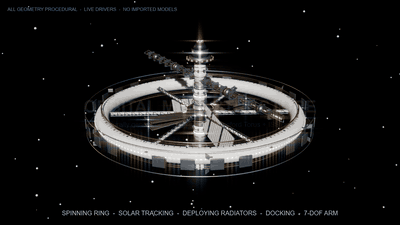

# 应用案例：程序化生成的会动的超写实太空站巨构

> 本页是 OpenCode × Blender Bridge 的一个**实际应用案例**：从空的初始场景出发，用纯 `bpy` 程序化几何（torus / 圆柱 / 锥 / 三角桁架 / 抛物面 / 合并网格 / 曲线管 / Geometry Nodes 实例化）生成一个超写实、带完整实时动画的轨道巨构，并渲染静帧与演示视频。它演示的是「用本桥接插件驱动 Blender」能做什么，不是插件本身的功能说明。
>
> **与[机器人装配案例](robot-assembly-and-animation.md)的区别**：机器人案例装配的是第三方 URDF/网格，需要顾及网格版权与归属；本案例**没有任何外部 3D 资产**——每一个螺丝、桁架、太阳能板、星星都由代码生成，不涉及第三方模型许可。与现有案例一致，复现脚本与成品保存在本地工作区、不随本插件仓库分发。
>
> [English summary](#english-summary) 见文末。

## 动画演示

下面这段循环动图是从案例 `.blend` 直接渲染、再用 ffmpeg 转成的全分辨率 GIF（1280×720，不压缩）；相机做螺旋环绕推近，叠加场景内全部实时动画。

<br>
<sub><b>轨道巨构</b> — 10 秒 / 8 fps 电影运镜（1280×720 全分辨率）：旋转环自转、太阳能翼对日跟踪、散热板展开、机械臂屈伸、飞船对接、屏蔽壳反旋</sub>

## 背景与目标

硬科幻里「可信的太空巨构」都遵循同一套分层语法，而真实工程又给它加了一层关键约束：**产生人工重力的旋转部件，必须与对日/对接/散热的非旋转部件通过可见的轴承 / 滑环分离**——否则整站当一个刚体转，工程上不成立，画面上也看不出「会动」的层次。

本案例的目标是验证一条**零外部资产、纯代码、可复现**的管线，把这套语法落成一个能看、能转、能渲染成片的 Blender 场景。结构语言依据取自公开的工程与设定资料（Stanford Torus / O'Neill / 2001 Space Station V 的旋转环 + 辐条 + hub 语法，叠加 ISS 的三角桁架、双轴太阳翼、散热板、MLI 金箔、抛物面天线、机械臂、对接舱细节），由联网检索的研究子代理汇总成「结构语法」后转译为几何参数——**只参考文字资料，不下载、不导入任何模型文件**。

```
空场景（默认 Cube / Camera / Light）
   │
   ▼  ① 材质库（PBR + 程序化微细节）+ 几何 helper + 动画 driver helper
   ▼  ② 受力骨架：中轴龙骨 / 6 根三角格构辐条 / 分层居住主环
   ▼  ③ 非旋转挂载：双轴太阳能翼 / 可展开散热板 / 天线 / 机械臂 / 飞船
   ▼  ④ 表皮与细节：MLI 金箔 / 三级 greeble / 辐射屏蔽壳 / 发光窗
   ▼  ⑤ 布光与后期：强太阳硬光 + 地球反照蓝边光 + 程序星空 + bloom
   ▼  ⑥ 实时 driver 动画（无关键帧烘焙）
   ▼  ⑦ 运镜相机 → EEVEE 逐帧渲染 → ffmpeg → MP4 / GIF + 静帧
```

## 结构（旋转 / 非旋转分离 —— 可信度核心）

| 层 | 部件 | 运动状态 |
| --- | --- | --- |
| **非旋转龙骨 SPINE** | 中轴三角桁架、5 段加压舱（金箔 MLI / 环筋 / 发光窗带）、轴向对接 hub（轴承 / 滑环 / 靶标）、底部 6 台离子引擎 | 静止 |
| **ROTOR 旋转环** | 6 根三角格构辐条（内含电梯管 + 节点舱）、分层主环（白色陶瓷壳、发光舷窗环、MLI 毯、瓦楞肋、服务环、节点舱、导航灯） | 绕 Z 持续自转（人工重力） |
| **非旋转挂载** | 横向电力桁架 + 8 片双轴太阳能翼（深蓝电池栅格 + 铜汇流条）、可展开竖直散热板（银白 + 氨管）、双轴抛物面高增益天线 + 小碟阵 + 7-DOF 机械臂、接近 / 停靠的飞船与交通艇 | 各自独立运动 |
| **SHIELD 屏蔽壳** | 稀疏月壤屏蔽瓦 + 支撑环 + chevron 镜面，与环留明显间隙 | 极慢反向旋转（0.07 rpm 量级） |
| **环境** | 程序星空（Geometry Nodes 实例化）、暗蓝地球弧、单一强太阳硬光 + 冷蓝地球反照边光 + fog-glow | — |

旋转环与龙骨之间显式做出**轴承外壳 / 铜滑环 / 转子套**的界面；太阳能翼的 SARJ（绕桁架轴连续旋转接头）也单独做出 roll-ring 硬件。这两处正是「内转外不转」的视觉证据。

## 会动（全部 driver 驱动，实时可播，无需烘焙）

| 部件 | 运动 | 驱动方式 |
| --- | --- | --- |
| 旋转环 + 辐条 | 绕 Z 持续自转 | `rotation_euler[2] = f * 0.012` |
| 太阳能翼 SARJ | 绕桁架轴连续对日跟踪 | `0.05 + f*0.0016*±1`（相邻站反向） |
| 太阳能翼 BGA | 第二轴缓慢俯仰，每翼相位不同 | `0.10 + 0.09*sin(f*0.010 + i)` |
| 天线碟 | 方位 + 俯仰双轴扫动 | 双 empty 嵌套 driver |
| 7 关节机械臂 | 肩 / 肘 / 腕屈伸 | 父子链 + 逐关节 driver |
| 散热板 | 铰链展开，前 140 帧缓动到位后停住 | `1.2 - 1.2*min(1,max(0,(f-1)/140))` |
| 对接飞船 | 沿 hub 轴缓慢靠近后锁止 | `33 - 9*min(1,max(0,(f-1)/300))` |
| 屏蔽壳 | 极慢反向旋转 | `-f * 0.0009` |

driver 用 `frame_current` 作单一变量（`SCRIPTED` + `SINGLE_PROP`），在 GUI 里拖时间轴即可看到所有机构联动；`scene.audit` 除两个星场点云（顶点靠 Geometry Nodes 实例化、网格本身无面，属预期）外无问题。

## 关键工程点（可复现的踩坑结论）

- **Blender 5.3 合成器改了 API**：`scene.node_tree` 已移除，改为 `scene.compositing_node_group`（`CompositorNodeTree` + `NodeGroupOutput` + interface socket）。bloom / fog-glow 必须走节点组，旧写法直接 `AttributeError`。
- **桥接 exec 环境没有 `__file__`**：`blender_rt_do(file=...)` 用 `exec` 执行，模块导入要靠显式 `sys.path`；因此 `run.py` 用 `SS_DIR` 环境变量 / `__file__` / `bpy.data.filepath` 三级回退推断脚本目录，既能在桥接里跑，也能 `blender -b --python` 独立跑。
- **跨阶段共享状态**：各阶段 `from ss_00_setup import *` 只拿到 helper 与材质，轮换空物体用共享字典 `SS["SPINE"]` / `SS["ROTOR"]` 传递，避免依赖模块级变量。
- **合并网格而非万级对象**：greeble（铆钉、面板缝、电池栅格、扶手）用单个 `bmesh` 合并成一个 mesh；桁架用一条 curve 多 polyline。360 个对象、约 6.3 万面，EEVEE 每帧不到 1 秒。
- **旋转装配的正确父子关系**：`parent_to` 保留世界矩阵（keep-transform），`attach` 把坐标当父级局部坐标用；辐条 / 环 / 屏蔽壳分别挂到不同旋转父级，才能出现「内转外不转」。
- **别把整个站当一个刚体转**：散热板、太阳翼、飞船全部挂在非旋转 SPINE 下；屏蔽壳单独挂一个极慢反旋 empty。
- **太空布光是明暗二分**：单一强平行太阳（硬边阴影）+ 冷蓝地球反照边光 + 近黑星空 + 少量 bloom；均匀环境光会把巨构照「平」。地球弧要压暗、推远，否则会变成一块盖住半屏的蓝板。
- **Windows 下 ffmpeg drawtext**：滤镜图里盘符冒号会和选项分隔符冲突；把字体复制到项目目录、用相对 `fontfile=arial.ttf` 并让 cwd = 项目根即可绕开。

## 与桥接插件的关系

- **GUI 路径**：`blender_viewport(op="launch")` 起一个带插件的 Blender → `blender_rt_do(file=run.py)` 一步重建 → 每阶段 `blender_rt_see` 回帧核对 → `blender_rt_plan` 做审计 / 渲染 / 导出 → `blender_rt_txn` 做快照。
- **无头路径**：`blender_rt_headless` / `blender_rt_job` 跑 240 帧序列渲染（长任务放后台，不阻塞 GUI），再用 ffmpeg 合成。
- **视频运镜**：`ss_08_video.py` 加一个 `CAM.Cinematic`，位置用 driver 做螺旋环绕 + 推近（半径 118→88、方位角扫约 2.5 rad、高度起伏），`TRACK_TO` 约束始终锁定站心；叠加场景内所有实时动画一起渲染。
- 桥接插件在此只负责「驱动 Blender + 取帧 + 批处理 + 后台任务」；建模本身是标准 `bpy` / `bmesh` / Geometry Nodes，**脱离插件也能用 `blender -b` 复现**。本案例已用无头 `blender -b --python run.py` 验证过完整重建（8 阶段 / 360 对象）。

## 成品与验证数字（实测）

| 项 | 值 |
| --- | --- |
| 场景对象 / 面数 | 360 对象（315 mesh / 11 curve / 26 empty / 3 light / 3 camera）· 约 63,000 面 |
| 材质 | 19 类 PBR 材质（拉丝铝 / 陶瓷 / 金箔 MLI / 深蓝光伏 / 银白散热 / 发光窗 / 铜…），含程序化皱褶法线 |
| 静帧 | `hero_final.png` / `wide.png`，1600×900，EEVEE 128 samples |
| 演示视频 | `ORBITAL_MEGASTRUCTURE_demo.mp4`，H.264 / 1280×720 / 24 fps / 10 s / 240 帧 / 4.06 MB |
| 循环动图 | `docs/media/orbital-megastructure.gif`，1280×720 全分辨率 / 8 fps / 80 帧 / 256 色 / 循环（约 21 MB，不压缩） |
| 导出 | `ORBITAL_MEGASTRUCTURE.glb`（含 PBR 材质，5.4 MB）、`.blend` 工程文件 |
| 审计 | `scene.audit`：仅 2 个星场点云「空网格」提示（GN 实例化，预期） |

## 复现骨架

工具链：Blender 5.3（GUI 经桥接驱动，或 `blender -b` 无头）、ffmpeg 9.0.1。本案例由 9 个分阶段脚本（`ss_00_setup.py` … `ss_08_video.py`）、一个重建引导器 `run.py`、以及渲染 / 编码脚本组成；它们与成品一起保存在本地工作区，不随本仓库分发。流程如下：

```bash
# 1) 从空场景重建整个模型（在桥接里用 blender_rt_do(file=run.py)，或命令行）
blender -b --factory-startup --python run.py               # 生成 8 阶段 / 360 对象场景

# 2) （可选）保存 .blend / 导出 GLB / 渲染静帧
#    在桥接里：file.save / export.scene / render.still

# 3) 加运镜相机并渲染 240 帧 PNG 序列（长任务，建议后台 job）
blender -b ORBITAL_MEGASTRUCTURE.blend --python render_video.py

# 4) 序列 → MP4（无字幕 / 带字幕二选一，PowerShell）
pwsh encode_video.ps1
pwsh encode_video_titles.ps1

# 序列 → GIF（全分辨率、不压缩）
ffmpeg -i ORBITAL_MEGASTRUCTURE_demo.mp4 \
  -vf "fps=8,split[s0][s1];[s0]palettegen=max_colors=256:stats_mode=full[p];[s1][p]paletteuse=dither=sierra2_4a:diff_mode=none" \
  -loop 0 orbital-megastructure.gif
```

其中 `run.py` 用 `SS_DIR` / `__file__` / `bpy.data.filepath` 三级回退推断脚本目录（兼容桥接 `exec` 与命令行），改参数后重跑即可，随机细节用固定 seed（`20261112`），结果确定性。`ss_08_video.py` 里的 `FRAMES` / 半径 / 方位角表达式可改时长与运镜轨迹。

> 字体：编码脚本默认从 `C:/Windows/Fonts` 取 Arial 用于字幕；非 Windows 平台请换成任一系统 TrueType 字体，或去掉 `-vf` 里的 drawtext 用无字幕版。

## 说明

- 本页为**应用案例文档**；`.blend`、`.glb`、`.mp4`、逐帧 PNG、静帧与复现脚本**都不随本插件仓库分发**，它们保存在本地工作区（与[机器人装配案例](robot-assembly-and-animation.md)一致）。仓库内只含**文档与演示 GIF**。
- 全部几何由本案例代码生成，**无第三方模型、无贴图、无外部 3D 资产**，因此没有版权 / 许可归属问题；结构参数参考的是公开工程与设定文字资料（NASA / NSS / Stanford / 硬科幻设定集），仅作设计依据。

---

<a id="english-summary"></a>

## English summary

This is an **application example** of the OpenCode × Blender Bridge: starting from the empty default scene, a photoreal, fully animated orbital megastructure is built entirely from procedural `bpy` geometry — torus, cylinders, cones, triangular space-frame trusses, a parabolic dish, merged `bmesh` greebles, curve tubes and Geometry Nodes star instancing. **No external 3D assets, meshes or textures are imported**; every rivet, truss, solar cell and star is generated in code, so no third-party model licensing is involved. As with the existing [robot case](robot-assembly-and-animation.md), the reproduction scripts and deliverables stay in the local workspace and are not distributed with this repository — only the write-up and the demo GIF are.

- **Structural grammar**: Stanford Torus / O'Neill / 2001 rotating-wheel syntax (spinning habitat ring + spokes + non-rotating hub) layered with ISS details (dual-gimbal solar wings, deployable radiators, MLI gold foil, high-gain dish, 7-DOF arm, docking craft). A research sub-agent gathered public engineering/design references as *text only* — no model files were downloaded.
- **Rotating / non-rotating split** — the credibility core: the habitat ring + spokes spin about Z for artificial gravity, while the axial keel, solar wings, radiators, antenna, arm and spacecraft stay on the non-rotating spine; visible bearing / slip-ring / roll-ring hardware marks the interface. A sparse regolith shield counter-rotates very slowly (0.07 rpm class).
- **Live animation, no keyframe baking**: every mechanism is a `SCRIPTED` driver on `frame_current` — ring spin, SARJ sun tracking, BGA pitch, dual-axis antenna, arm joints, an eased radiator deployment (first 140 frames), a docking approach that latches, and the slow shield counter-rotation. Scrubbing the timeline animates everything.
- **Photoreal look**: 19 PBR materials with procedural micro-detail (brushed metal, crumpled gold MLI, deep-blue PV cells, emissive windows), three-tier greeble density, a single hard sun + cold-blue earthshine rim + near-black procedural starfield + fog-glow bloom; hard two-tone lighting rather than flat ambient.
- **Deliverables (measured)**: 360 objects / ~63k polygons; 1600×900 EEVEE stills; a 10 s / 24 fps / 240-frame 1280×720 H.264 demo (4 MB); a full-resolution 1280×720 / 8 fps looping GIF (uncompressed, 256 colours); a PBR GLB and the `.blend`. `scene.audit` is clean apart from two expected star-field point clouds (GN-instanced, faceless source meshes).
- **Blender 5.3 notes**: the compositor moved to `scene.compositing_node_group`; the bridge's `exec` has no `__file__`, so `run.py` infers its directory via `SS_DIR` / `__file__` / `bpy.data.filepath` fallbacks. The full rebuild was verified headless with `blender -b --python run.py` (8 phases / 360 objects).
- **Bridge role**: the plugin drives a live Blender GUI (launch → `blender_rt_do` → `blender_rt_see` → `blender_rt_plan` audit/render/export), runs the 240-frame render as a background job, and returns frames. The modeling is plain `bpy`/`bmesh`/Geometry Nodes and reproduces with `blender -b` without the plugin.

Deliverables (`.blend`, `.glb`, `.mp4`, frame sequence, stills) and the reproduction scripts stay in the local workspace and are not distributed with this repository; only this write-up and the demo GIF are added.
