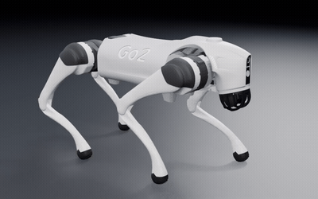
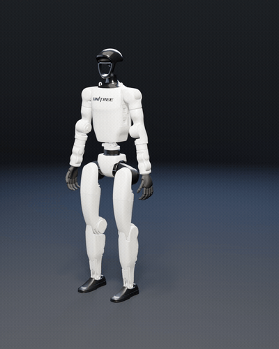
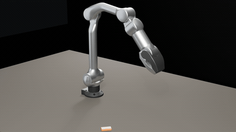
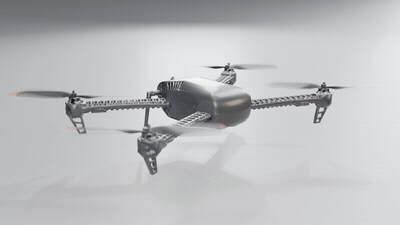

# 应用案例：从 URDF 网格装配到循环动画

> 本页是 OpenCode × Blender Bridge 的一个**实际应用案例**，说明如何把开源机器人描述文件（URDF / xacro / SDF）及其官方网格，装配成带层级骨架、材质和循环动画的 Blender 场景，并批量产出三视图、视频和数值验证报告。它演示的是「用本桥接插件驱动 Blender」能做什么，不是插件本身的功能说明。
>
> [English summary](#english-summary) 见文末。

## 背景与目标

机器人仿真社区提供了大量带官方网格的开源描述（Unitree、PX4 等），但这些文件是给物理引擎看的：碰撞体、惯量、无材质层级、无展示动画。本案例的目标是验证一条**通用、可复现、不写死机型**的管线：

```
开源网格 (STL / DAE→OBJ / glTF)  +  URDF / xacro / SDF
      │
      ▼  ① 解析 link / joint / visual，递归计算
            T_link = T_parent · T_joint ,  T_mesh = T_link · T_visual
            （每个 link 一个空物体，网格按 visual origin 挂到 link 上）
      ▼  ② 数值验证：独立 FK 对比、脚底 z=0、间隙 / 穿模、包围盒
      ▼  ③ 按 URDF 材质名 / 网格分组赋 PBR 材质
      ▼  ④ 动画：FK 采样 / 解析 IK / 平面 2-link IK 打关键帧（24 fps 循环）
      ▼  ⑤ EEVEE 渲染：hero / side / front 三视图 + 逐帧序列
      ▼  ⑥ ffmpeg → animation.mp4 / animation.gif + report.txt / progress.json
```

同一段解析 / 校验 / 渲染逻辑已成功适配 **4 种形态**：四足机器狗、人形机器人、6 轴机械臂、四旋翼 —— 腿式、臂式、旋翼共用一套 FK 装配，无需针对机型改代码。

## 用途（这套装配 + 动画能拿来做什么）

1. **机器人可视化 / 宣传素材**：把仿真描述变成统一灯光下的产品级渲染（3/4 hero、正/侧视图）与循环演示视频，用于官网、展板、PPT、课程物料，无需手工摆拍或重画。
2. **仿真资产 → 交互资产的桥梁**：URDF/SDF 转成「带父子骨架 + PBR 材质 + 动画」的 `.blend`，可继续导出 glTF/GLB 给网页、游戏引擎、AR/VR、three.js 使用。
3. **运动学 / 机构教学与 URDF 校验**：FK 数值核对、DOF 与关节限位、步态 / 抓取 / 旋翼反扭的可视化；用间隙、穿模、接地、镜像检查当「URDF 写得对不对」的第二双眼睛。多形态对照特别适合机器人学课程。
4. **批量动画素材生成**：一条管线稳定产出多机型、多步态、多机位的循环 MP4/GIF，参数可复现、命名一致、带机器可读的 `report.txt` / `progress.json`，适合做数据集、基准测试与 UI 动效素材源。
5. **论文 / 课件 / 网页插图**：带数值报告的正交三视图，风格统一、可溯源、许可清晰。
6. **下游资产管线对照基准**：结构化 `model.blend` + 渲染 + 报告，可作 glTF 导出、网格简化、材质重映射、姿态估计等任务的输入或对照组。

**边界**：这是**运动学展示**，不是动力学 / 物理仿真（无刚体求解、无接触力学）；网格多为仿真级简化件，非精确 CAD；版权许可（如 BSD-3）不等于商标或外观设计授权，商用需自行核对。

## 关键工程点（可复现的踩坑结论）

- **Z-up 保持**：Blender 5.2 已移除 Collada 导入器，DAE 用无依赖解析器转 OBJ（保留 `Z_UP`）；**不经 GLB 中转**，因为 GLB 会静默把 Z-up 翻成 Y-up，破坏关节朝向。STL 本身已是 Z-up / 米制，直接 `forward=Y / up=Z` 导入。
- **零猜旋转**：所有 `rpy`、镜像、`visual origin` 取自 URDF，由 link tree 决定；不做「补个 π」「手动挪一点」这类手调（曾因此把四足前后腿装反、后髋留缝）。
- **可验证装配**：用独立 numpy FK 与 Blender 求值后的世界矩阵逐 link 对比，误差 1e-7 量级；再查接地、关节间隙、非安装类穿模、关节角限位。
- **动画不穿地**：四足用平面 2-link IK 保证支撑相脚底 `z=0`；旋翼用线性曲线闭环；机械臂用 `scipy.least_squares` 在限位内解抓取位。
- **批量 / 并行**：每个形态一个独立目录、一个 `progress.json` 阶段跟踪，多 agent 可并行互不干扰。
- **许可与归属**：成品目录内附 `report.txt` / `PROVENANCE.txt` / 许可文本，逐项记录来源、提交、改动。

## 与桥接插件的关系

- **GUI 路径**（四足机器狗）：`blender_rt_do(file=..., see=true)` 在正在看的 Blender 会话里逐步装配、每步回一帧，配合 `blender_rt_plan` 做渲染 / 导出，`see` / `watch` 用于人工核对朝向与缝隙。
- **无头路径**（人形 / 机械臂 / 无人机）：`blender -b --factory-startup --python build_*.py` 直接批处理，或经桥接的 `headless` / `job` 工具跑长任务。
- 桥接插件在此只负责「驱动 Blender + 取帧 + 批处理」；装配本身是标准 `bpy` 空物体层级 + `matrix_parent_inverse`，不依赖插件私有 API，脱离插件也能用 `blender -b` 复现。

## 动画演示

下面 4 段循环动画都是从各自的 `model.blend` 直接渲染、再用 ffmpeg 转成的轻量 GIF。

<table>
  <tr>
    <td align="center" width="50%">
      <br>
      <sub><b>四足 Go2</b> — 48 帧 trot 步态（URDF FK，12 DOF）</sub>
    </td>
    <td align="center" width="50%">
      <br>
      <sub><b>人形 G1</b> — 96 帧 idle + 挥手（39 link / 29 DOF）</sub>
    </td>
  </tr>
  <tr>
    <td align="center" width="50%">
      <br>
      <sub><b>6 轴机械臂 Z1</b> — 96 帧抓取-搬运-放置（IK）</sub>
    </td>
    <td align="center" width="50%">
      <br>
      <sub><b>四旋翼 Iris</b> — 48 帧桨转 + 悬停闭环</sub>
    </td>
  </tr>
</table>

## 成品与验证数字（实测）

| 形态 | 来源 / 许可 | 装配 | 动画 | 验证 |
| --- | --- | --- | --- | --- |
| 四足 Go2 | `unitree_ros / go2_description`，BSD-3 | URDF FK，12 DOF，官方 DAE→OBJ | 48 帧 trot | FK 误差 1.49e-7；髋–大腿间隙 1.19 mm；四脚 z=0 |
| 人形 G1 | `unitree_ros / g1_description`，BSD-3 | 39 link / 38 joint / 29 DOF | 96 帧 idle + 挥手 | FK 平移 2.78e-7 m；脚底漂移 0；L/R 对称 1e-5 m；手–髋 0 相交 |
| 6 轴臂 Z1 | `unitree_ros / z1_description`，BSD-3 | base + 6 关节 + 夹爪 | 96 帧抓取-搬运-放置（IK） | FK 0.000295 mm；7 个抓取位 IK 残差 0；定子–方块 0 面相交 |
| 四旋翼 Iris | `PX4/PX4-gazebo-models`，BSD-3 | 机身 STL 拆件 + 桨 DAE→OBJ | 48 帧桨转 + 悬停 | 电机对角 500 mm；桨毂轴对齐 |

每个成品目录通常含 `model.blend`、`animation.mp4`（+ 部分 `animation.gif`）、`hero.png` / `side.png` / `front.png`、`report.txt`、`PROVENANCE.txt`、许可文本、`progress.json`、`scripts/` 重建脚本、`renders/` 逐帧 PNG。

### 穿模检查

动画做完后对每个 `model.blend` 逐帧做了网格互穿检查（BVH 面对撞，配合顶点内外测试交叉验证），并修掉了动画造成的穿模：

- **Go2 / Iris**：无异常。
- **G1**：垂臂时手掌压进髋部。给两侧肩 roll 关节逐帧叠加 12° 外展后，手–髋、手–躯干、手–膝等对撞全部归零，脚底仍在 `z=0`。
- **Z1**：47 mm 方块被夹爪上棱咬入。实测这副夹爪在抓取点只张开约 27 mm，且指间空腔中心偏离腕轴约 4 mm；把方块改为 22.5 mm、绕 Z 转到与夹爪同向、并移入空腔中心后，定子与方块 0 面相交。另外修正了桌面顶面高度（原先在 `z = −12.5 mm`，方块放下后会悬空 12.5 mm），现在放置后正好落在台面上。

## 复现骨架

工具链：Blender 5.2.2 LTS（`blender -b` 无头或经桥接驱动 GUI）、ffmpeg 9.0.1、Python（numpy / scipy 用于 IK 与 FK 校验）。

```bash
# 1) 取官方网格（示例：Unitree Z1 机械臂）
git clone --filter=blob:none --no-checkout git@github.com:unitreerobotics/unitree_ros.git %TEMP%\unitree_ros_z1
#    把 robots/z1_description 里的 xacro 与 visual 网格放进 assets/z1/

# 2) 解析 URDF joint tree + FK 装配 + 96 帧动画 → model.blend
blender -b --factory-startup --python build_z1.py -- --stills
blender -b --factory-startup --python build_z1.py -- --anim

# 3) 序列 → 视频
ffmpeg -framerate 24 -start_number 1 -i frames/frame_%04d.png \
       -c:v libx264 -pix_fmt yuv420p animation.mp4
```

其余机型脚本形态相同：解析各自 URDF → 建 `LINK_*` / `J_*` 空物体树 → 挂 `T_visual` 网格 → 按机构类型打关键帧 → 渲染 + 校验。

## 说明

- 本页为**应用案例文档**，成品 `.blend`、视频、渲染图与第三方网格不随本插件仓库分发；它们保存在本地工作区，各自目录带完整来源与许可说明。
- 第三方网格归原作者所有，按各自许可使用：四足 Go2、人形 G1、6 轴机械臂 Z1 来自 [unitreerobotics/unitree_ros](https://github.com/unitreerobotics/unitree_ros)（BSD-3-Clause），四旋翼 Iris 来自 [PX4/PX4-gazebo-models](https://github.com/PX4/PX4-gazebo-models)（BSD-3-Clause）；名称 / logo 归各自权利人，本案例未获任何厂商背书。

---

<a id="english-summary"></a>

## English summary

This is an **application example** of the OpenCode × Blender Bridge: a reproducible pipeline that turns open-source robot descriptions (URDF/xacro/SDF) and their official meshes into Blender scenes with a link/joint empty hierarchy, PBR materials and looped animations, then batch-renders three-view stills, MP4/GIF and numeric verification reports.

- **Method**: parse the joint tree, compute `T_link = T_parent · T_joint` and `T_mesh = T_link · T_visual`; verify against an independent FK pass (1e-7 m); keyframe via FK sampling / analytic IK / planar 2-link IK; render with EEVEE; encode with ffmpeg.
- **One pipeline, four morphologies**: quadruped, humanoid, 6-DOF arm and quadcopter — no per-robot hardcoding.
- **Use cases**: robot visualization & marketing imagery, simulation-asset → interactive-asset (glTF) bridging, kinematics teaching and URDF correctness checks, batch animation-asset generation, paper/course figures, and a baseline for downstream asset pipelines.
- **Limits**: kinematic presentation only (no dynamics/contact physics), simulation-grade meshes, and copyright licenses do not grant trademark or industrial-design rights.
- **Interpenetration check**: every `model.blend` was scanned frame by frame for mesh intersections (BVH face overlap plus point-inside tests). Animations that pushed a hand into the hip (G1) or the jaw into the carried block (Z1) were fixed by a 12° shoulder abduction and by sizing/turning the block to the claw's real 27 mm opening respectively; the Z1 table top was also corrected to `z=0` so the released block rests on it; Go2 and Iris were clean.
- Bridge role: the plugin drives a live Blender session (GUI) or `blender -b` headless and returns frames; the assembly itself is plain `bpy` code and reproduces without the plugin.

Deliverables and third-party meshes are kept in the local workspace with their own `report.txt` / `PROVENANCE.txt` / license files; they are not distributed with this plugin repository.
